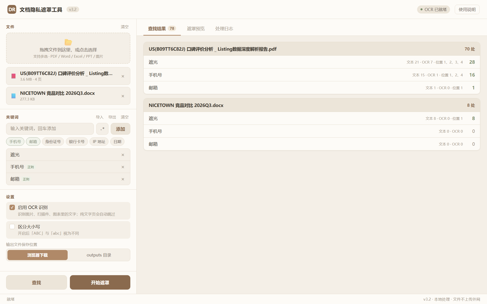
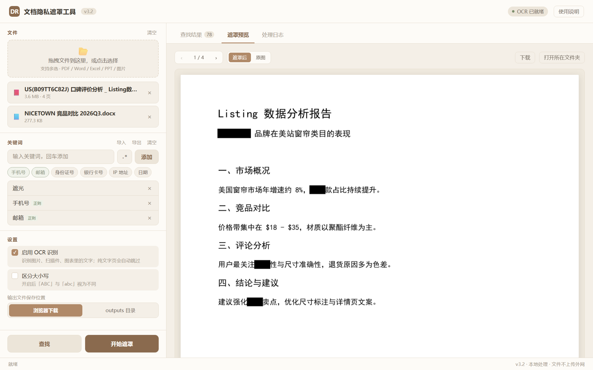

# DocRedact · 文档隐私遮罩工具

> 批量把 PDF / Word / Excel / PPT / 图片里的敏感信息**真正删除**，而不是盖一层黑块。
> 纯本地运行，文件不出本机，适合处理合同、报价单、客户名单、平台数据报告等。


---

## 目录

- [为什么不用「画个黑框」](#为什么不用画个黑框)
- [功能](#功能)
- [界面](#界面)
- [快速开始](#快速开始)
- [使用流程](#使用流程)
- [技术实现](#技术实现)
- [性能实测](#性能实测)
- [项目结构](#项目结构)
- [自行打包](#自行打包)
- [测试](#测试)
- [常见问题](#常见问题)
- [已知限制](#已知限制)
- [许可证](#许可证)

---

## 为什么不用「画个黑框」

大多数「PDF 打码」做法是往页面上盖一个黑色矩形。文件发出去后，对方**全选、复制、粘贴到记事本**，被遮住的字原样躺在里面；用任何提取工具也能直接读出来。

DocRedact 走的是 PyMuPDF 的内容流删除：

- **文字**：`apply_redactions()` 把命中的字符从页面内容流里移除，复制不出来、也搜不到
- **图片**：`PDF_REDACT_IMAGE_PIXELS` 直接抹掉图片对应区域的像素，不是叠加图层
- **Word / Excel / PPT**：把命中文字替换成实心块 `█`，不残留原文

项目自带的反向验证能证明这一点——遮罩完成后重新对输出做 OCR，原本识别得到的「遮光」「NICETOWN」全部识别不出来了。

---

## 功能

| 能力 | 说明 |
|---|---|
| 原生窗口 | 双击即开，不弹浏览器标签页，任务栏里就是一个普通软件 |
| 多格式 | PDF、DOCX、XLSX、PPTX、PNG / JPG / BMP / TIFF |
| 双层识别 | PDF 文本层按**字符**精确匹配；扫描件 / 截图 / 图表走 OCR |
| 精准框选 | OCR 使用逐字符坐标，只遮关键词本身，不漏字也不吃掉整行 |
| 正则规则 | 内置手机号、邮箱、身份证号、银行卡号、IP、日期预设，也可自己写正则 |
| 批量处理 | 一次最多 30 个文件、50 条规则，逐个处理互不阻塞 |
| 真实进度 | 异步任务 + 分页进度，可随时取消 |
| 遮罩预览 | 处理完逐页翻看，可一键切换「遮罩后 / 原图」对比 |
| 选择保存位置 | 浏览器下载，或直接落盘到 `outputs/` 目录 |
| 规则持久化 | 关键词自动保存在浏览器本地，支持 JSON 导入导出 |
| 纯本地 | 服务只监听 `127.0.0.1`，局域网内其它设备访问不到，没有任何外部请求 |

支持大小写敏感开关；关键词支持中文、英文、数字混排，也支持一行内多次出现（重叠匹配）。

---

## 界面

**查找结果**：按文件分组，每条规则分别统计文本层与 OCR 命中数、出现在哪几页。



**遮罩预览**：逐页核对效果，一键对比原图。



---

## 快速开始

### 方式一：安装包（推荐，无需 Python）

1. 下载 Release 里的 `DocRedact_v3.3_setup.exe`（约 100 MB）
2. 双击运行，跟着向导下一步（**不需要管理员权限**，装到当前用户目录）
3. 桌面或开始菜单会出现「DocRedact 文档隐私遮罩工具」

装完双击即开，**直接弹出程序窗口，不打开浏览器**。OCR 模型已内置，完全离线。

卸载走「设置 → 应用」或开始菜单里的卸载项；`uploads/`、`outputs/` 里的处理结果不会被删除。

> 程序用系统自带的 WebView2 内核渲染界面（Win10 / Win11 均预装）。
> 极少数精简版系统若提示缺失，装一下微软官方的 WebView2 Runtime 即可。

### 方式一·备选：免安装绿色版

Release 里同时提供 `DocRedact_v3.3_win64_portable.zip`，解压后双击 `DocRedact.exe` 即可，不写注册表。

### 方式二：源码运行

```bash
git clone https://github.com/SmileFzr/DocRedact.git
cd DocRedact

pip install -r requirements.txt
python app.py
```

首次运行会自动下载 OCR 模型（约 22MB，仅一次），之后完全离线。

也可以双击 `start_web.bat`。

---

## 使用流程

1. **加文件**：拖拽或点击选择，支持多选
2. **加规则**：
   - 输入框输入关键词 → `添加`（或回车）
   - 点「手机号 / 邮箱 / 身份证号…」预设一键添加
   - 点输入框右侧 `.*` 切换正则模式，再输入表达式
3. **点「查找」**：先看命中数量与所在页，确认规则没有误伤
4. **点「开始遮罩」**：等待进度完成
5. **核对与导出**：切到「遮罩预览」逐页确认 → 「下载」或「打开所在文件夹」

> 扫描件 / 截图类 PDF 记得保持「启用 OCR 识别」打开；纯文字 PDF 会自动跳过 OCR，速度很快。

---

## 技术实现

```
原生窗口（pywebview + 系统 WebView2 内核）
   │  载入单文件 SPA，fetch JSON
Flask 后端（127.0.0.1 随机端口 + 任务队列 + 进度轮询 + 路径校验）
   │
redact_engine.py
   ├─ PDF 文本层：rawdict → 逐字符 bbox → 滑窗匹配
   ├─ PDF 图片层：150dpi 渲染 → RapidOCR → 逐字符框 → 比例回映
   ├─ Office：python-docx / openpyxl / python-pptx 文本替换
   └─ 图片：OCR → PIL 绘制实心块
```

界面仍然是那套 HTML/CSS，只是渲染容器从浏览器换成了程序自己的窗口 ——
双击即开，没有地址栏、没有标签页，任务栏里就是一个普通软件。源码运行（`python app.py`）时仍走浏览器，方便调试。

几个踩过坑的关键点：

**1. 文本层必须用 `rawdict`**
`page.get_text("dict")` 不带 `chars` 字段，拿不到单字坐标。改用 `rawdict` 后才能真正做到「只遮这两个字」。

**2. 文本层遮罩框不能外扩**
PyMuPDF 删除文字的逻辑是「矩形与字符框**有任何相交**就删」。早期给框加了 1pt 余量，结果「申请遮光配件」里的「请」「配」被一起删掉。现在 pad 固定为 0，靠字形框本身覆盖。

**3. OCR 用逐字符框，而不是按比例估算**
RapidOCR 默认返回整行框，按「字符数 × 平均宽度」估算关键词位置，中英混排时必然偏移，所以早期版本会出现「有的露左边、有的露右边」。
现在调用 `return_word_box=True` 拿每个字符的真实坐标，命中范围直接取对应字符框。

**4. OCR 文本和字符框对不上**
OCR 返回的文本行含空格，但逐字符结果不含空格，直接比长度会整行对不齐。用 `difflib.SequenceMatcher` 做容错对齐，空格位置留空、退化为比例估算，其余字符精确映射。

**5. 性能门控**
早期版本只要开了 OCR，**每一页**都渲染 + 识别（一页约 40 秒）。现在先判断：无文本层，或图片面积占比 > 2% 才跑 OCR。纯文字页从 40 秒降到 0.04 秒。

**6. 超大页面降采样**
5000pt 以上的海报 / 长图，150dpi 会渲染出上亿像素。加 6000px 上限后内存可控，同时实测命中数不变（21 vs 22 的差异出现在 4000px，6000px 完全一致）。

**7. 双层去重**
同一处文字可能同时被文本层和 OCR 命中（比如带文字的图片）。按交叠面积 > 50% 判为同一处，计数不重复。

---

## 性能实测

测试机型：Windows 11 + Python 3.13 + onnxruntime CPU

| 场景 | 耗时 |
|---|---|
| 纯文字 PDF（OCR 门控跳过） | 约 0.04 秒/页 |
| 扫描件 / 图片页（PP-OCRv5 @150dpi） | 约 1.5–2 秒/页 |
| 4 页混合文档（2 页需 OCR），查找 | 5.8 秒 |
| 同一文档遮罩输出 | 5.5 秒 |
| 2588×4348pt 大页（旧版 46 秒） | 22 秒 |

---

## 项目结构

```
DocRedact/
├── app.py                    # Flask 后端：路由、任务队列、安全校验
├── redact_engine.py          # 遮罩引擎：PDF / OCR / Office / 图片
├── app_exe.py                # 桌面版启动器：后台跑服务 + pywebview 原生窗口
├── app_exe.spec              # PyInstaller 打包配置（含模型/Native 依赖补位）
├── installer.iss             # Inno Setup 安装包脚本
├── installer/
│   └── ChineseSimplified.isl # 安装向导简体中文语言包
├── icon.ico                  # 程序图标（多尺寸）
├── tools/
│   └── make_icon.py          # 生成 icon.ico 与预览图
├── start_web.bat             # 源码运行/浏览器模式的一键启动
├── 使用说明.txt               # 给最终用户看的简版说明
├── web_ui/
│   └── index.html            # 前端单文件（无构建步骤）
├── tests/
│   ├── make_test_pdf.py      # 生成 4 页测试文档
│   ├── selftest_engine.py    # 18 项引擎验收
│   └── make_screenshots.py   # 生成 README 截图
├── docs/                     # README 截图
├── requirements.txt
└── LICENSE
```

`tests/` 里的脚本不依赖工作目录，从任何位置执行都会自动切到仓库根目录，产物统一写到 `outputs/`（已 gitignore）。

---

## 自行打包

**第一步：生成 exe**

```bash
pip install -r requirements.txt pyinstaller pywebview
pyinstaller app_exe.spec --clean
```

产物在 `dist/DocRedact/`（约 272 MB）。

**第二步：生成安装包**

装 [Inno Setup 6](https://jrsoftware.org/isdl.php) 后：

```bash
"C:\Program Files (x86)\Inno Setup 6\ISCC.exe" installer.iss
```

产物在 `release/DocRedact_v3.3_setup.exe`（约 100 MB）。

`app_exe.spec` 里有三个容易踩的坑，已经处理好：

- **OCR 模型必须显式打包**：RapidOCR 的 `config.yaml`、`default_models.yaml` 和 `models/*.onnx` 作为 datas 带入，否则目标机器无网络时 OCR 直接不可用
- **MSVC 运行时版本对齐**：依赖里可能混进很旧的 `msvcp140.dll`（14.26），而 onnxruntime 1.26 需要新版运行时，否则 import 时报「DLL 初始化例程失败」，OCR 静默失效。spec 里统一替换为系统最新版本
- **WebView2 原生加载器要补位**：`Microsoft.Web.WebView2.Core.dll` 被放在 `webview/lib/`，而它 P/Invoke 的 `WebView2Loader.dll` 被归到了 `runtimes/win-x64/native/`。冻结后 .NET 只在程序集同目录找原生依赖，找不到就初始化失败——表现是**窗口能打开但一片空白，且不报任何错**。spec 在 COLLECT 之后自动把 DLL 拷到 Core.dll 旁边

---

## 测试

仓库内自检脚本覆盖 18 项断言（引擎层）：

- 扫描计数 = 遮罩计数
- 输出文本层无残留关键词
- 相邻文字不被误删（面料 / 配件 / 申请）
- 图片页遮罩后**重新 OCR** 找不到关键词（反向验证）
- 遮罩区域确实变黑
- 图片 / DOCX / XLSX / PPTX 遮罩正确
- 大小写敏感开关生效
- 取消机制生效
- 输出页数一致

```bash
python tests/make_test_pdf.py      # 先生成测试文档（4 页，含扫描件/密排页）
python tests/selftest_engine.py    # 再跑 18 项验收，约 15 秒
```

首次运行验收脚本会加载 OCR 模型，末行输出 `通过 18/18` 即为正常。

---

## 常见问题

**Q：双击 exe 没反应？**
看是否有黑色控制台窗口一闪而过。若被杀毒软件拦截，加入信任列表后重试。启动需要 5–15 秒（要加载 OCR 模型），期间浏览器可能打不开，稍等刷新即可。

**Q：提示端口被占用？**
程序会自动从 5000 往后找可用端口（最多试 20 个），实际地址以控制台打印为准。

**Q：扫描件里的字没遮住？**
确认勾选了「启用 OCR 识别」。低分辨率（<100dpi）或严重倾斜的扫描件识别率会下降，建议先「查找」看命中数是否符合预期。

**Q：为什么偶尔会多遮半个字？**
OCR 字符框来自识别结果，字距极密的排版下框会略有偏差。宁可多遮一点点，也不漏 —— 隐私工具漏掉一处比多遮一处危险得多。

**Q：能处理加密 PDF 吗？**
不能，会提示无法打开。请先用其它工具去掉密码。

**Q：文件会上传到服务器吗？**
不会。服务只监听 `127.0.0.1`，全部处理在本机完成，没有任何外发请求。

---

## 已知限制

- 竖排 / 大幅旋转的文字，OCR 识别率有限
- 手写体、艺术字、极低分辨率截图识别率不高
- Office 文档遮罩会把关键词替换成 `█`，无法保留原字符格式（跨 run 时整段格式可能合并）
- 加密 / 损坏的 PDF 直接报错，不做修复
- 仅提供 Windows 10/11 64 位版本，其它平台请走源码运行
- 界面依赖系统自带的 WebView2 内核（Win10/11 预装）；Win7 或精简系统需自行安装 WebView2 Runtime，否则会降级为浏览器模式
- 窗口内拖拽上传在部分 WebView2 版本上可能不响应，改用左侧「选择文件」按钮即可

---

## 许可证

[MIT](LICENSE)

OCR 能力基于 [RapidOCR](https://github.com/RapidAI/RapidOCR) 与 PaddleOCR 的 PP-OCRv5 模型，PDF 处理基于 [PyMuPDF](https://github.com/pymupdf/PyMuPDF)。
